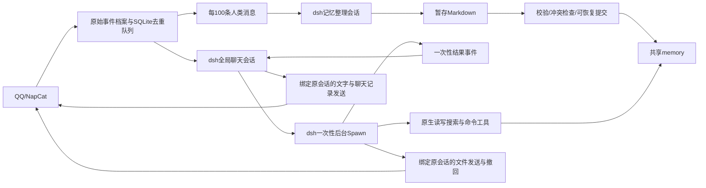

# AI 服务：dsh 双会话架构与部署

## 本次改造

聊天和记忆整理分别使用一个持久化 dsh 会话。所有群聊和私聊共用聊天会话，历史消息包含真实QQ号、昵称、场景、时间和消息ID；记忆整理共用另一个会话。聊天启用原生一次性 Spawn 子 Agent，主 Agent 只处理对话和分派。没有 Attention、可续聊/多层子 Agent 或03:00记忆任务。

锁定官方 npm 版本 `@deepseek-ai/dsh@0.2.1-rc.2`（2026-10-17发布的next预发布版本），依赖完整锁在 `dsh/package-lock.json`。官方仓库：https://github.com/deepseek-ai/deepseek-harness 。`dsh/profile.yml` 组合官方模型适配器、Agent循环、JSONL会话持久化、工作目录服务、token计量、自动上下文压缩、原生read/write/edit/glob/grep、Bash/PowerShell和SKILL。模型循环及上下文压缩由官方实现承担。

Python处理QQ事件、持久消息队列、文件/OCR、记忆提交、后台任务来源及OneBot回执；Node插件桥接业务能力、原生工具权限和 Spawn 生命周期。两端仅监听127.0.0.1，使用启动时生成的随机令牌，模型无法指定回调地址。不会启动dsh网页、SDK公网服务、MCP、可续聊子Agent或插件管理。

## 一次性后台 Spawn

主 Agent 可使用 `send_message`、`send_forward_message`、`find_sticker`、`send_sticker`、`spawn_task`、`task_status`、`cancel_task`。原生文件/搜索/命令、记忆检索、附件处理、文件发送和撤回工具从主对话的工具列表移除，执行守卫也会拒绝直接调用；主人身份不能绕过这条角色边界。普通聊天可直接回答，凡需获取或核实新信息、执行操作的工作均委派，包括简单的联网查询和“请记住”；复杂分析、长篇资料及多步骤工作也交给执行者。主对话缺少执行工具不代表整个机器人缺少能力；普通用户可以委派原生联网查询，命令行仍限主人。提示词明确列出这些触发场景、示例及启动回执要求，后台结果交付回合不再委派。

`spawn_task(title,prompt)` 使用官方 `dsh-subagent` 服务和 `dsh-subagent-spawn-in-process` provider，调用 `ctx.subagents.startActivation({provider:'spawn', delivery:'caller', ...})`；模型、工具循环、文件观察、网页搜索及压缩继续使用 dsh 原生实现。工具只等待子 Agent 接受任务，立即返回任务 ID，不等待 `activation.result`，因此主回合结束和新消息到达都不会取消它。普通后台任务使用Spawn；定时任务另外使用原生fork。虽然新内核支持可续聊子Agent，本项目仍只暴露一次性任务，不能继续委派，深度上限为1。

宿主提前保留childId，在子Agent创建时绑定任务权限和工具过滤；不再使用新版已删除的request.toolFilter/localAgent接口。`delivery:'caller'`将唯一结果交给Python已有交付队列，避免内核再次自动唤醒共享主对话或重复交付。入队前通过AbortController取消，入队后显式调用activation.dispose()终止执行；原生result在会话刷新和资源释放后完成。文件和命令工具通过workingDirectory服务获得当前目录，宿主仍校验它必须与任务目录一致。

子 Agent 使用全新上下文，不复制主对话整段历史；宿主附上原请求、真实 QQ、主人授权、绑定场景、引用、文件目录及独立原文输入文件，主 Agent 在说明中补充必要事实与交付要求。人设、账号身份、整体架构及记忆SKILL同样强制注入。权限固定来自发起请求，不能因主对话后来切换到主人或别的群而扩大。各任务使用独立 QQ 回调和发送计数；文件最多3次、20MiB，目的地始终是原会话。

子 Agent 不能发送聊天文字或聊天记录；可使用 `send_file` 交付文件。结束后向宿主返回一次结果并释放内核句柄，文字结果作为 `background_result` 排入共享主对话，由主对话按上下文显式调用发送工具交付；静默任务或文件已交付且无需补充时可零发送。这一交付回合不能再 Spawn，结果文本不视为新授权。文件修改和下载可以保留；临时原文输入在任务结束时清理，子会话日志使用来源原文的剩余保留期，最长7天。

QQ发送采用显式工具边界：主聊天、私聊、后台交付与AI定时分支均不把`final_response`自动发到QQ。被@、提到网名或私聊意味着必须受理，不要求必须发言；正常结束可零发送，也没有空回复兜底。Spawn不自动发受理回执或公开内部任务编号，需要确认时由主对话显式调用发送工具。真实聊天请求执行失败且没有发送尝试时保留固定错误提示；后台交付回合失败仅记日志。定时`message`模式必须收到至少一次QQ发送工具的成功回执，否则记为交付失败（`delivery_missing`），原因在admin/日志显示；未知发送仍记为unknown，禁止自动重试。内部笔记留在内部记录，不通过关键词过滤正常聊天内容。

同时最多4个任务，每位请求者每个QQ会话最多2个，满额返回 `task_capacity`；不自动重排或重复提交。用户询问进度时查询 `task_status`，明确取消时调用 `cancel_task`，只能查看/取消本人在同一会话的任务。状态最多保存最近50个已结束任务，查询时清理1小时前状态。新聊天及补充说明不会自动修改任务；需要改要求时取消后重建。

取消、关闭AI、保存AI配置、服务停止、运行时重启或上下文到期都会终止任务；在途QQ操作可能无法撤销，已完成文件修改不回滚。后台执行状态不跨进程恢复、不自动重做，因此重启后如需继续，应先检查已有文件再发起新任务。原人设和记忆SKILL微调保留；内核升级保护见下方说明。

提示词入口：`src/feature/ai/engine.py` 的 `CHAT_RULES`（主对话）和 `WORKER_RULES`（执行子Agent）；整体说明在 `src/feature/ai/self_description.md`；硬性角色与路径权限在 `dsh/policy.mjs`，原生生命周期桥接在 `dsh/plugin.mjs`。

### 工具名单由谁决定

宿主程序决定角色和工具范围，不由模型根据提示词挑选或授权。`dsh/profile.yml` 加载原生工具，`dsh/plugin.mjs` 注册QQ业务工具，再通过每个Agent作用域的 `tools.restrict()` 筛选模型可见的工具。主对话保留上述7个工具，后台结果交付回合保留文字/聊天记录发送与表情查找/发送共4个工具；普通Spawn执行者移除分派工具及文字/聊天记录/表情发送工具，保留文件发送；定时fork仅移除分派工具，保留文字、聊天记录、表情和文件发送。记忆整理的列表目前仅移除分派工具，其余能力仍由执行守卫限制，工具出现在schema里不代表有权执行。

模型只能从可见名单中选择调用。调用时，`dsh/policy.mjs` 检查固定角色、主人授权、任务有效期和文件路径，Python `engine.py` 再检查真实QQ场景、发送次数、功能开关及定时任务的silent模式。`delivery=message` 要求发送成功回执，`auto` 允许按任务判断是否发送，`silent` 拒绝所有QQ发送；这些模式不会把最终文本自动发到QQ。DeepSeek联网搜索还会发起只带搜索工具的独立模型请求，该请求不能代表定时Agent本身的工具名单。

每轮首次模型执行前，以及后续工具名单变化时，应用日志输出一条 `dsh工具注入` 记录，包含宿主任务ID、Agent会话ID、角色、是否后台交付及实际作用域的工具名；不输出提示词、参数或聊天正文。每个模型步骤都会检查定时分支的三个发送工具是否齐全；缺少时立即停止，admin执行记录显示 `SEND_TOOLS_MISSING`，不让模型继续执行一个无法交付的分支，也不自动放宽权限或重试。排查漏发时，应先对应任务与角色，再区分工具缺失、没有选择发送、调用被拒绝和NapCat发送失败。

定时分支结束时，另外记录 `AI定时任务发送统计`：业务任务ID、运行ID、场景、发送模式、宿主侧尝试计数、成功次数及未知回执类型；auto/silent和异常退出也会记录。这个计数只涵盖到达Python发送处理器的尝试，不能用零次数排除dsh侧提前拒绝。`auto` 的completed仅表示执行正常结束，不证明QQ交付成功；模型声称“没有工具”同样不等于实际工具schema缺失，须结合工具名单与回执判断。



## 数据目录

### 媒体后台解析与迟到补充

QQ事件先原封不动保存到raw，再快速登记顶层附件及“媒体后台解析中”占位。OCR、vision以及合并转发的网络展开在独立的持久队列中执行，最多同时处理两个消息任务；每个消息内按原位置解析所有图片/PDF。相同图片在不同消息中可复用结果，不要求用户点名才解析。待处理任务和已完成的附件部分保存在 `.state/media-jobs.sqlite3`，重启后恢复；远端转发内容一经取得也保存快照，重试不必重复拉取。普通非图片/PDF附件仍仅记录元数据。

`.state/media-cache.sqlite3` 按文件字节、模型连接、OCR开关、人设身份与解析版本区分缓存。并发同图只做一次OCR/vision，文件名保留在原附件元数据，不写入共享视觉描述。只有完整成功结果入缓存，失败保留OCR证据并有限退避重试；三次失败后停止，Agent可显式重试。缓存不存原始图片，最多5000条、正文总计128MiB，最长30天；复用不延长原到期时间。修改视觉提示或OCR规则时需同步提升 `MediaCache.VERSION`。

`read_media` 仅允许执行者和定时分支读取本场景结果，可按消息ID/附件ID查询、等待最多30秒、优先处理排队任务或明确重试失败任务。完整转述保存在对应raw记录旁的 `.rendered.txt`，超过工具预览长度时可由执行者原生read；消息原始JSON不改写。主对话须spawn执行者等待，其他聊天继续处理。后台解析不自动发送QQ消息或自动唤醒主Agent。

`messages.sqlite3` 升级时只增加media_updates表，保留既有消息、游标和记忆文件。媒体结果按修订号进入独立补充队列；原消息已整理时，不重复计作人类消息，不等待下100条，自动学习开启即可补充整理。少量迟到结果按约10秒窗口合并，避免每个表情包单独触发一次记忆模型；手动整理不受此延迟影响。整理在读取批次时捕获修订号，提交只确认已捕获版本，提交期间到达的新版本继续保留；失败复用原有暂存/冲突保护。主聊天在下一次正常回合收到尚未见过的解析补充，保持原发送者、场景、时间，明确标注不是新发言。

原文、转述、转发快照、附件部分和相关补充均按源消息30天期限清理；过期任务不再发布结果。关闭AI暂停新解析，已开始的请求可能先结束，但不会在关闭期间发布；重启无需手动迁移。admin的AI运行信息显示等待、进行中、重试、失败任务数及待整理媒体补充数。来源下载链接过期、超出原有文件/转发深度限制或模型持续失败时仍可能无法完成，失败状态不会冒充解析成功。

独立定时模块使用 `data/timing/tasks.sqlite3` 保存任务及回执；AI定时执行从主聊天已完成历史fork，不阻塞主对话，结束后删除分支日志。提供场景内固定消息及AI任务的增删改查工具与安全批次整理工具：确定文本用固定消息，动态获取或AI生成用AI任务，详见[定时任务使用说明](定时任务使用说明.md)。chat、memory与定时分支可并行，记忆批次共用事务锁。

```text
data/ai/
  config.yaml                       账号、功能开关与本地记忆配置（不存模型密钥）
  .state/
    messages.sqlite3                事件去重、100条队列和完成游标（不存正文）
    dsh-migration.json              自启动迁移完成记录
    dsh-upgrades/runtime.json       内核版本、准备/成功状态及备份位置
    dsh-upgrades/<升级ID>/          校验过的旧会话备份，按原会话期限清理
    pre-dsh-config.yaml             迁移前配置快照
    context.json                   撤回/总结使用的有限近期消息缓存
    memory-commit.json              提交中断时的重做日志；完成后删除
    memory-batch-receipt.json       最近成功批次回执
  .vector_cache/                    原有本地BGE模型和可重建Chroma索引
  dsh-home/                        官方持久会话、期限元数据与受清理临时目录
  workspace/
    AGENT.md                       唯一聊天人设，管理界面可编辑
    .agents/skills/memory-management/
      SKILL.md                     记忆执行者按需读取的目录、分类与读写规则
      scripts/search.py            可选的纯Python记忆搜索脚本
    .agents/skills/qqbot-guide/
      SKILL.md                     宿主更新的完整机器人说明，按需读取
    memory/
      user/<QQ>/PERSON.md
      user/<QQ>/PREFERENCE.md
      user/<QQ>/RECENTNESS.md
      user/<QQ>/memory/<主题>.md
      group/<群号>/<任意主题>.md    群规、专属梗、共同活动与群体项目；仅一层.md
      common/GLOSSARY.md
      raw/<日期>/<消息身份哈希>.json 原始QQ事件及原文，不用模型转述替代
      raw/<日期>/*.rendered.txt      单独保存的OCR/转发展开内容，同样保留30天
      raw/legacy/                  原样迁移的旧Markdown聊天档案
    files/<场景哈希>/              接收、生成和发送的会话文件
    tmp/                           可重建的聊天输入与整理暂存，使用后清理
```

`SKILL.md` 模板在 `src/feature/ai/skills/memory-management/SKILL.md`，首次启动复制到工作区，此后保留你的微调。宿主启动时仅刷新末尾 `qqbot:memory-layout:start/end` 标记之间的目录规范，来源为 `src/feature/ai/memory_layout.md`；规范只保存在SKILL中，不会作为独立系统上下文重复注入。dsh仅提供简短SKILL路径提示，涉及记忆查询、编辑或整理时由执行者使用skill或read按需读取全文，普通聊天无需加载；主对话委派子Agent读取并执行。可选 `scripts/search.py` 随部署更新，旧内容不同时备份为 `scripts/search.py.pre-upgrade.bak`。实际运行可微调SKILL的非托管部分，下次读取生效。聊天基础规则在 `src/feature/ai/engine.py` 的 `CHAT_RULES`，整理任务规则在 `src/feature/ai/runtime.py`。原生工具权限在 `dsh/policy.mjs`，它们不随人设修改而放宽。

每轮只提供人设（聊天任务）、机器人身份、简短角色规则、`src/feature/ai/core_prompt.md` 的公共边界，以及 `self_context.py` 生成的当前身份、权限、路径和开关；动态JSON紧凑序列化，不重复附上模块使用资料或admin帮助全文。主对话保持只聊天和分派，显式发送、静默、跨场景隐私和真实授权等关键规则保留；详细工具参数只在工具定义中说明，不另附撤回/合并转发长篇规则。

完整架构、模块命令、admin功能和操作说明仍在 `src/feature/ai/self_description.md`。启动时作为宿主管理的 `workspace/.agents/skills/qqbot-guide/SKILL.md` 发布，执行者需要功能细节时用原生skill/read读取；它不会覆盖人设或自定义记忆SKILL，也不再每轮注入全文。指南的微调请修改源码；工作区副本随部署启动更新。涉及记忆的任务仍须先读取memory-management SKILL。已有会话下一轮使用精简规则，历史记录按dsh原有保留和压缩策略管理，无需清空会话或记忆。

FeatureManager通过通用 `bind_application_context` 回调提供模块信息；每轮仅注入模块name/title/enabled摘要。详细 `agent_usage`、普通帮助全文及主人帮助改由执行者调用 `get_bot_help()` 按需读取，与admin和 `/help` 共用实时数据，保存/恢复后立即可查，不写入共享工作区文件。主人帮助同时检查本次任务的固定主人授权和请求者当前仍为绑定主人；模型参数不能授权，普通任务和已撤销授权的任务不返回主人帮助。主对话须委派执行者查询，整理对话不能调用此工具。帮助内容不能授权或创造AI工具；AI仍不能直接调用JM/Pixiv业务队列。

以相同临时配置（AI和帮助两个模块、默认人设）测量，主对话的Python宿主提示词由13,524字符降至2,106字符，执行子Agent由12,961降至2,090，定时任务由12,945降至2,126。这里只统计固定宿主提示词，不含消息历史、工具schema、dsh附加内容和按需查询结果；字符数并非计费token，实际费用还受缓存命中和任务长度影响。

## 队列、记忆与上下文

每条收到的人类消息全局计数一次，机器人自己发的、回显重复消息、系统事件不计数。绑定口令不入档。事件先保存原始JSON，再做附件OCR和视觉转述；转述是派生上下文，与原文分开。

达到100条自动提交最早100条给整理会话。后续消息继续持久入队，不会被正在整理的批次吞掉。每批先复制正式画像到暂存目录，让dsh原生编辑；只有最终明确返回对应批次完成JSON、任务成功结束且文件合法时，宿主才检查旧文件哈希并发布，再将本批出队。失败丢弃暂存、保留队列，后台每分钟重试。提交重做日志和批次回执支持中途重启恢复。人工编辑造成冲突时重新整理，不覆盖他人的新内容。管理员可手动整理剩余不足100条。

原始档案按滚动30天清理，不因整理失败无限延期；超过保留期仍未处理的数量写入 `.state/retention_warning.json`。长期提炼的Markdown记忆保留。原文缓存、临时批次、dsh物理日志及命令输出也纳入清理；物理会话最长7天，并受最旧可读原文的剩余期限约束，轮换后通过保留期内的原文和长时记忆继续逻辑对话。清理在启动及每分钟运行，存在最多约一分钟的调度粒度。

所有原始新消息都有可读路径；模型输入只展示有限预览，大批积压放输入文件，Agent可以原生读取。dsh根据原生模型目录和默认策略自动压缩。SQLite是队列依据，dsh摘要不是队列游标。向量索引不索引原始聊天，原生编辑后会按内容哈希同步或重建；不可用时降级为Markdown文本检索，不再让Attention二次筛选。

正式长期记忆仅包括上列user、group路径及common/GLOSSARY.md；group下可自由命名.md，但不允许再嵌套目录。三类均参与向量索引、文本回退、自动整理暂存及admin增删改查。`search_memory`的scope支持auto/user/group/common；target_qq只过滤用户部分，target_group只过滤群部分，auto仍包含其他类型，只查某群须指定scope=group。已有 `workspace/memory/group/<群号>/*.md` 无需迁移，下次检索会检测新增文件并同步索引；其他层级或非规范文件仍不纳入流程，不能靠重建索引补收。整理暂存中发现非法.md路径会拒绝整批提交。

## 权限和发送

主人身份沿用管理界面的绑定机制，当前 `ctx.user_id` 必须与 `MasterService.master_id` 一致。转发、历史记录、昵称、自称主人及模型参数都不能提供主人授权。每轮重新计算；主人权限不从共享历史或上轮任务继承。

普通用户可以读取工作区、编辑自己的合法Markdown画像、当前群的合法群记忆及当前场景files目录；私聊不能编辑群记忆，不能写规则、他人画像、其他群记忆或其他场景文件，也不能调用任意命令或访问工作区外路径。群写入权限绑定宿主从真实QQ事件传入的group_id，子Agent和定时分支继承当次真实场景，不从模型参数或共享历史获取授权。符号链接越界、硬链接和搜索路径逃逸受到检查。整理会话没有主人身份，只可写暂存用户/群记忆和公共知识，可检索正式记忆，不能发送QQ消息、执行命令或修改服务器。

主人当前请求可以使用原生Bash（Linux）或PowerShell（Windows），以及工作区外读写，其操作范围取决于服务进程的OS权限。Docker方式可控制容器及挂载目录；要控制宿主服务器，应使用下面的原生部署方式。没有默认挂载Docker socket或整个宿主根目录。

主对话回合按全局顺序执行，后台 Spawn 的执行不占用这个队列。其他群的新聊天只等待当前对话回合；同一场景、同一请求者明确说“等等/取消刚才/纠正一下/补充一下/先别”会取消正在输出的旧主回合再处理新消息，已启动的子任务由主 Agent 根据新意图显式调用 cancel_task。取消或关闭功能撤销工具桥接与原生运行。已经送到NapCat的在途动作无法事后取消，按回执记录真实结果。

QQ工具不接受任意目标，始终绑定当轮真实请求场景。最多4条文字、1张合并转发卡片、3个文件；发送失败返回结构化错误，权限不足保留 `permission_denied`，超时是 `unknown`，本轮禁止重复该类发送。撤回仍执行当前场景/已知或引用消息检查。文件只能从当前场景files目录导出，单文件20MiB。

## 升级与迁移

### dsh 0.2.0-rc.2 → 0.2.1-rc.2

本次兼容已有v4 JSONL会话，原目录直接续接，不清空聊天或记忆会话。`workspace`、人设、用户自定义记忆SKILL、原始记录、100条队列/游标、向量缓存、主人绑定、Pixiv/JM配置、定时任务SQLite均不需要因内核升级转换。

旧会话清单缺少cwd字段时，Python先只读会话头确认目录，保持原聊天游标；内核在升级备份完成后补齐清单并续接。只有目录确实变化（例如容器迁到原生部署）或会话到期时才轮换：先撤销关联后台任务和定时分支的权限、等待清理并释放旧句柄，再创建新会话。目录迁移后由保留期内的原文重新播种聊天上下文；旧物理日志仍按原期限清理，不因目录变化立即删除。

停止旧进程后部署新版并启动即可。首次内核启动（或先运行到会话保留期清理）会执行 `src/feature/ai/dsh_upgrade.py`，在写入新内核数据之前备份 `dsh-home/sessions` 和 `qqbot-*.json` 到 `data/ai/.state/dsh-upgrades/<升级ID>/runtime/`。`snapshot.json`记录SHA-256校验值；复制、空间或校验失败就停止升级，保留源文件。临时命令文件与自动生成的profiles不属于会话状态，不复制。准备标记原子落盘，启动失败后重试复用已有完整备份；收到内核就绪回执才标记新版本已启用。依赖实际版本不符时明确报错，需执行npm ci，不会悄悄使用旧内核。

备份不复制已过期会话，也不复制整份业务data。备份的到期时间取所含会话最早截止时间，避免把聊天原文保留超过原有期限；每分钟清理时删除到期备份。更新前自行保存整个data副本仍是完整回滚的保障。升级脚本不会自动用旧备份覆盖之后生成的新记忆或业务记录。

需要回退时先停止服务，保留当前data副本，在备份仍有效且校验通过时，将该备份的runtime目录作为旧版本的整个dsh-home恢复，并将代码和npm锁文件一同回退；不要把两代会话日志混合。workspace和业务数据库无需替换。若要回到升级前的全部业务状态，应恢复自行保存的完整data备份。

可在停机后提前执行 `python scripts/migrate_ai.py --root data/ai`，它同时执行旧架构迁移和本次内核备份准备。Docker重建沿用 `./data:/app/data`；原生部署需在dsh目录执行 `npm ci` 后重启服务。模型继续使用 `deepseek-flash`，无需修改现有Key或端点。联网搜索保留兼容的原生Messages搜索与HTTP抓取路径，本次没有自动切换到新独立搜索API。

### 更早的AI架构迁移

旧版本先停止，再部署新版本；不要让两个版本同时使用同一data目录。建议升级前自行保留整个data备份。首次构造AI服务会自动调用 `src/feature/ai/migrate.py`：

1. 原样移动旧 `user/`、`common/` 到 `workspace/memory/`，旧 `raw/` 到 `workspace/memory/raw/legacy/`。
2. 复制唯一人设到 `workspace/AGENT.md`，保留账号配置、主人绑定及本地嵌入模型缓存；原文保留设置更新为30天。
3. 同名目标内容一致可继续；不同则停止并显示冲突，不覆盖目标。中途停止后可重跑。
4. 写完成标记，后续启动直接跳过。旧已整合记忆继续可用；旧原文只作历史档案，不重新算入新100条队列。

可在停止服务时提前运行 `python scripts/migrate_ai.py --root data/ai`。迁移保留能找到的数据，但无法恢复此前7天保留策略已删除的旧日志。因旧目录移动、配置/会话格式变更，回退旧版本需要恢复升级前data备份。

### Docker

```bash
docker compose up -d --build --remove-orphans
```

新镜像包含Node.js 24、锁定npm依赖、Python、Tesseract中英文/繁体语言包及Poppler，已经移除ai-sandbox侧车。`./data:/app/data` 挂载保持不变。`--remove-orphans` 清理旧侧车，不删除data。首次启动自动迁移。

### 原生服务器（需要主人控制宿主时）

先安装Node.js >=24、npm、Python >=3.11及venv。在Debian/Ubuntu上安装 `tesseract-ocr tesseract-ocr-eng tesseract-ocr-chi-sim tesseract-ocr-chi-tra poppler-utils fonts-noto-cjk`。

```bash
bash deploy/install-host.sh
# 按服务器实际目录、用户和权限修改deploy/myqqbot.service
sudo cp deploy/myqqbot.service /etc/systemd/system/myqqbot.service
sudo systemctl daemon-reload
sudo systemctl enable --now myqqbot
```

安装脚本安装CPU版torch、本地嵌入和文件库、npm锁定依赖，并预执行迁移。`User=`决定主人可用的服务器权限；需要管理员权限时由你选择相应服务账号。自定义环境放 `.env.host`，systemd的EnvironmentFile无需 `export`。管理界面密码和QQ主人绑定继续沿用原有配置。

### API兼容性

模型固定使用 `deepseek-flash`，聊天、记忆整理、视觉和 `/short` 均使用这个官方别名。dsh从官方内置模型目录读取上下文能力，输出预算、空闲超时、重试与压缩采用官方默认策略。Python保留现有回合超时和锁泄漏看门狗，防止服务过载后聊天队列永久阻塞；本次内核升级不改变这些设置，也不增加轮数或Token限制。

密钥只从进程环境读取，优先 `DEEPSEEK_API_KEY`，兼容 `AI_API_KEY`。复制根目录 `.env.example` 为 `.env` 并填入密钥；Python本地启动会读取 `.env`，Docker Compose会把相关值注入容器。systemd可使用 `.env.host`。管理界面只显示“环境已配置/未配置”，不能读写密钥或模型连接参数。升级时会移除现有 `data/ai/config.yaml` 的密钥、模型及旧限额设置，升级前需先把密钥配置到环境；旧迁移备份不会被自动改写。

可选环境变量：

- `AI_API_URL`：视觉/总结使用的OpenAI兼容地址，默认 `https://api.deepseek.com`。
- `AI_DSH_API_URL`（兼容 `DEEPSEEK_BASE_URL`）：dsh的Anthropic Messages地址，默认 `https://api.deepseek.com/anthropic`，适配器追加 `/v1/messages`。
- `DEEPSEEK_SEARCH_BASE_URL`：原生搜索的独立地址，默认 `https://api.deepseek.com/anthropic/v1`，搜索适配器追加 `/messages`。

### 联网搜索

直接挂载官方 `dsh-web`、`dsh-web-search-deepseek`、`dsh-web-fetch-http` 和 `dsh-tool-web`。聊天通过原生 `web_search({queries:[...]})` 搜索、`web_fetch({url:...})` 阅读网页；整理会话依然禁止联网。复用同一个DeepSeek Key，移除Tavily/SearXNG桥接和管理接口，旧 `data/web_search/` 配置不再读取。

DeepSeek搜索通过独立Messages调用返回结构化搜索结果，会产生该次模型调用的耗时和Token费用；不会仅凭模型声称“搜索过”就算成功。中转地址必须支持DeepSeek原生服务端搜索，否则工具明确返回失败。网页抓取使用官方公共地址验证、DNS固定和重定向检查，拒绝内网/回环地址。

官方依据：[dsh原生搜索](https://github.com/deepseek-ai/deepseek-harness/blob/master/packages/web/web-search-deepseek/README.md)、[DeepSeek模型文档](https://api-docs.deepseek.com/quick_start/pricing/)。

### 管理界面

AI页分为记忆库、账号与功能、检索与维护三个标签。记忆库按昵称/QQ分组，可筛选分类或主题，点击即打开；新建只需填写QQ、分类和事件主题，不必输入路径。支持未保存提醒、版本冲突检查、重新读取和删除；删除同样校验版本，避免误删Agent的新修改。检索结果可直接跳回对应文件。账号人设和功能开关保留，模型/密钥/限额及第三方搜索表单已移除。

## 验证

```bash
cd dsh && npm ci && npm test
cd ..
python -X utf8 -m unittest discover -s tests -v
```

Python测试使用临时数据、本地Messages模拟服务器和实际安装的官方dsh，覆盖原生工具读写、上下文持久化、全局场景路由、权限回落、取消、QQ错误回传、记忆编辑提交及队列恢复；不需要真实模型密钥，不发真实QQ消息。若未安装Node/npm依赖，真实内核测试会明确跳过。实际群聊、NapCat附件和真实模型表现仍需部署后验收。
