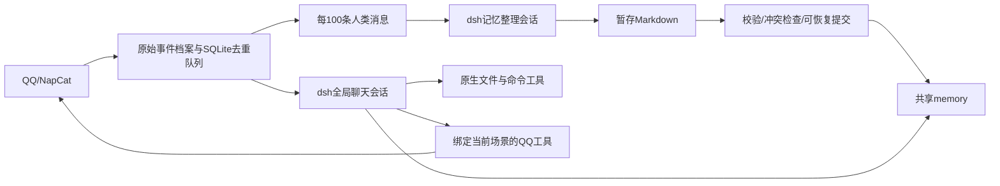

# AI 服务：dsh 双会话架构与部署

## 本次改造

聊天和记忆整理分别使用一个持久化 dsh 会话。所有群聊和私聊共用聊天会话，历史消息包含真实QQ号、昵称、场景、时间和消息ID；记忆整理共用另一个会话。没有主/子Agent、Attention或continue判断Agent，也没有03:00记忆任务。

锁定官方 npm 版本 `@deepseek-ai/dsh@0.2.0-rc.2`，依赖完整锁在 `dsh/package-lock.json`。官方仓库：https://github.com/deepseek-ai/deepseek-harness 。`dsh/profile.yml` 组合官方模型适配器、Agent循环、JSONL会话持久化、token计量、自动上下文压缩、原生read/write/edit/glob/grep、Bash/PowerShell和SKILL。模型循环及上下文压缩由官方实现承担。

Python处理QQ事件、持久消息队列、文件/OCR、记忆提交和OneBot回执；Node插件只桥接这些业务能力和原生工具执行权限。两端仅监听127.0.0.1，使用启动时生成的随机令牌，模型无法指定回调地址。不会启动dsh网页、SDK公网服务、MCP、子Agent、插件管理或后台任务工具。



## 数据目录

```text
data/ai/
  config.yaml                       模型、账号、开关配置
  .state/
    messages.sqlite3                事件去重、100条队列和完成游标（不存正文）
    dsh-migration.json              自启动迁移完成记录
    pre-dsh-config.yaml             迁移前配置快照
    context.json                   撤回/总结使用的有限近期消息缓存
    memory-commit.json              提交中断时的重做日志；完成后删除
    memory-batch-receipt.json       最近成功批次回执
  .vector_cache/                    原有本地BGE模型和可重建Chroma索引
  dsh-home/                        官方持久会话、期限元数据与受清理临时目录
  workspace/
    AGENT.md                       唯一聊天人设，管理界面可编辑
    .agents/skills/memory-management/
      SKILL.md                     两个会话每轮硬性必读的分类与读写规则
      scripts/search.py            可选的纯Python记忆搜索脚本
    memory/
      user/<QQ>/PERSON.md
      user/<QQ>/PREFERENCE.md
      user/<QQ>/RECENTNESS.md
      user/<QQ>/memory/<主题>.md
      common/GLOSSARY.md
      raw/<日期>/<消息身份哈希>.json 原始QQ事件及原文，不用模型转述替代
      raw/<日期>/*.rendered.txt      单独保存的OCR/转发展开内容，同样保留30天
      raw/legacy/                  原样迁移的旧Markdown聊天档案
    files/<场景哈希>/              接收、生成和发送的会话文件
    tmp/                           可重建的聊天输入与整理暂存，使用后清理
```

`SKILL.md` 模板在 `src/feature/ai/skills/memory-management/SKILL.md`，首次启动复制到工作区，此后不覆盖你的微调。实际运行请修改工作区的副本，每轮会重新读取。聊天基础规则在 `src/feature/ai/engine.py` 的 `CHAT_RULES`，整理任务规则在 `src/feature/ai/runtime.py`。原生工具权限在 `dsh/policy.mjs`，它们不随人设修改而放宽。

## 队列、记忆与上下文

每条收到的人类消息全局计数一次，机器人自己发的、回显重复消息、系统事件不计数。绑定口令不入档。事件先保存原始JSON，再做附件OCR和视觉转述；转述是派生上下文，与原文分开。

达到100条自动提交最早100条给整理会话。后续消息继续持久入队，不会被正在整理的批次吞掉。每批先复制正式画像到暂存目录，让dsh原生编辑；只有最终明确返回对应批次完成JSON、任务成功结束且文件合法时，宿主才检查旧文件哈希并发布，再将本批出队。失败丢弃暂存、保留队列，后台每分钟重试。提交重做日志和批次回执支持中途重启恢复。人工编辑造成冲突时重新整理，不覆盖他人的新内容。管理员可手动整理剩余不足100条。

原始档案按滚动30天清理，不因整理失败无限延期；超过保留期仍未处理的数量写入 `.state/retention_warning.json`。长期提炼的Markdown记忆保留。原文缓存、临时批次、dsh物理日志及命令输出也纳入清理；物理会话最长7天，并受最旧可读原文的剩余期限约束，轮换后通过保留期内的原文和长时记忆继续逻辑对话。清理在启动及每分钟运行，存在最多约一分钟的调度粒度。

所有原始新消息都有可读路径；模型输入只展示有限预览，大批积压放输入文件，Agent可以原生读取。dsh根据配置的上下文阈值自动压缩。SQLite是队列依据，dsh摘要不是队列游标。向量索引不索引原始聊天，原生编辑后会按内容哈希同步或重建；不可用时降级为Markdown文本检索，不再让Attention二次筛选。

## 权限和发送

主人身份沿用管理界面的绑定机制，当前 `ctx.user_id` 必须与 `MasterService.master_id` 一致。转发、历史记录、昵称、自称主人及模型参数都不能提供主人授权。每轮重新计算；主人权限不从共享历史或上轮任务继承。

普通用户可以读取工作区、编辑自己的合法Markdown画像及当前场景files目录；不能写规则、他人画像、其他场景文件，也不能调用任意命令或访问工作区外路径。符号链接越界、硬链接和搜索路径逃逸受到检查。整理会话没有主人身份，只可写暂存画像，可检索正式记忆，不能发送QQ消息、执行命令或修改服务器。

主人当前请求可以使用原生Bash（Linux）或PowerShell（Windows），以及工作区外读写，其操作范围取决于服务进程的OS权限。Docker方式可控制容器及挂载目录；要控制宿主服务器，应使用下面的原生部署方式。没有默认挂载Docker socket或整个宿主根目录。

聊天请求按全局顺序执行。其他群的新消息排队；同一场景、同一请求者明确说“等等/取消刚才/纠正一下/补充一下/先别”会取消旧任务再处理新消息。取消或关闭功能会撤销旧任务工具桥接与原生运行。已经送到NapCat的在途动作无法事后取消，按回执记录真实结果。

QQ工具不接受任意目标，始终绑定当轮真实请求场景。最多4条文字、1张合并转发卡片、3个文件；发送失败返回结构化错误，权限不足保留 `permission_denied`，超时是 `unknown`，本轮禁止重复该类发送。撤回仍执行当前场景/已知或引用消息检查。文件只能从当前场景files目录导出，单文件20MiB。

## 升级与迁移

旧版本先停止，再部署新版本；不要让两个版本同时使用同一data目录。建议升级前自行保留整个data备份。首次构造AI服务会自动调用 `src/feature/ai/migrate.py`：

1. 原样移动旧 `user/`、`common/` 到 `workspace/memory/`，旧 `raw/` 到 `workspace/memory/raw/legacy/`。
2. 复制唯一人设到 `workspace/AGENT.md`，保留模型配置、主人绑定及本地嵌入模型缓存；原文保留设置更新为30天。
3. 同名目标内容一致可继续；不同则停止并显示冲突，不覆盖目标。中途停止后可重跑。
4. 写完成标记，后续启动直接跳过。旧已整合记忆继续可用；旧原文只作历史档案，不重新算入新100条队列。

可在停止服务时提前运行 `python scripts/migrate_ai.py --root data/ai`。迁移保留能找到的数据，但无法恢复此前7天保留策略已删除的旧日志。因旧目录移动、配置/会话格式变更，回退旧版本需要恢复升级前data备份。

### Docker

```bash
docker compose up -d --build --remove-orphans
```

新镜像包含Node.js 24、锁定npm依赖、Python、Tesseract中英文/繁体语言包及Poppler，已经移除ai-sandbox侧车。`./data:/app/data` 挂载保持不变。`--remove-orphans` 清理旧侧车，不删除data。首次启动自动迁移。

### 原生服务器（需要主人控制宿主时）

先安装Node.js >=24、npm、Python >=3.11及venv。在Debian/Ubuntu上安装 `tesseract-ocr tesseract-ocr-eng tesseract-ocr-chi-sim tesseract-ocr-chi-tra poppler-utils fonts-noto-cjk`。

```bash
bash deploy/install-host.sh
# 按服务器实际目录、用户和权限修改deploy/myqqbot.service
sudo cp deploy/myqqbot.service /etc/systemd/system/myqqbot.service
sudo systemctl daemon-reload
sudo systemctl enable --now myqqbot
```

安装脚本安装CPU版torch、本地嵌入和文件库、npm锁定依赖，并预执行迁移。`User=`决定主人可用的服务器权限；需要管理员权限时由你选择相应服务账号。自定义环境放 `.env.host`，systemd的EnvironmentFile无需 `export`。管理界面密码和QQ主人绑定继续沿用原有配置。

### API兼容性

dsh官方DeepSeek适配器使用 **Anthropic Messages协议**。新增 `dsh_api_url`，留空时由旧 `api_url` 去掉末尾 `/v1` 后加 `/anthropic`；官方示例为 `https://api.deepseek.com/anthropic`，适配器会追加 `/v1/messages`。

视觉/OCR转述和 `/short` 仍用原来的OpenAI兼容传输，它们是一次性资料处理，不参与聊天工具循环。若你使用只支持 `/chat/completions` 的中转，必须另外提供Messages兼容的 `dsh_api_url`；仅改模型名称不能转换协议。API Key沿用现有配置，可用AI_API_KEY环境变量覆盖。

## 验证

```bash
cd dsh && npm ci && npm test
cd ..
python -X utf8 -m unittest discover -s tests -v
```

Python测试使用临时数据、本地Messages模拟服务器和实际安装的官方dsh，覆盖原生工具读写、上下文持久化、全局场景路由、权限回落、取消、QQ错误回传、记忆编辑提交及队列恢复；不需要真实模型密钥，不发真实QQ消息。若未安装Node/npm依赖，真实内核测试会明确跳过。实际群聊、NapCat附件和真实模型表现仍需部署后验收。
