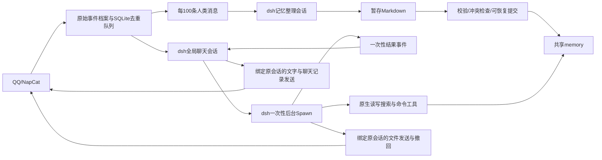

# AI 服务：dsh 双会话架构与部署

## 本次改造

聊天和记忆整理分别使用一个持久化 dsh 会话。所有群聊和私聊共用聊天会话，历史消息包含真实QQ号、昵称、场景、时间和消息ID；记忆整理共用另一个会话。聊天启用原生一次性 Spawn 子 Agent，主 Agent 只处理对话和分派。没有 Attention、可续聊/多层子 Agent 或03:00记忆任务。

锁定官方 npm 版本 `@deepseek-ai/dsh@0.2.0-rc.2`，依赖完整锁在 `dsh/package-lock.json`。官方仓库：https://github.com/deepseek-ai/deepseek-harness 。`dsh/profile.yml` 组合官方模型适配器、Agent循环、JSONL会话持久化、token计量、自动上下文压缩、原生read/write/edit/glob/grep、Bash/PowerShell和SKILL。模型循环及上下文压缩由官方实现承担。

Python处理QQ事件、持久消息队列、文件/OCR、记忆提交、后台任务来源及OneBot回执；Node插件桥接业务能力、原生工具权限和 Spawn 生命周期。两端仅监听127.0.0.1，使用启动时生成的随机令牌，模型无法指定回调地址。不会启动dsh网页、SDK公网服务、MCP、可续聊子Agent或插件管理。

## 一次性后台 Spawn

主 Agent 只有 `send_message`、`send_forward_message`、`spawn_task`、`task_status`、`cancel_task`。原生文件/搜索/命令、记忆检索、附件处理、文件发送和撤回工具从主对话的工具列表移除，执行守卫也会拒绝直接调用；主人身份不能绕过这条角色边界。普通聊天可直接回答，凡需执行的工作均委派，包括“请记住”这样的简单修改。

`spawn_task(title,prompt)` 使用官方 `dsh-subagent` 服务和 `dsh-subagent-spawn-in-process` provider，调用 `ctx.subagents.start('spawn', ...)`；模型、工具循环、文件观察、网页搜索及压缩继续使用 dsh 原生实现。宿主持有独立 AbortController，工具只等待子 Agent 创建，立即返回任务 ID，不等待 `run.result`，因此主回合结束和新消息到达都不会取消它。普通后台任务使用Spawn；定时任务另外使用原生fork。没有continuable或子Agent继续委派，深度上限为1。

子 Agent 使用全新上下文，不复制主对话整段历史；宿主附上原请求、真实 QQ、主人授权、绑定场景、引用、文件目录及独立原文输入文件，主 Agent 在说明中补充必要事实与交付要求。人设、账号身份、整体架构及记忆SKILL同样强制注入。权限固定来自发起请求，不能因主对话后来切换到主人或别的群而扩大。各任务使用独立 QQ 回调和发送计数；文件最多3次、20MiB，目的地始终是原会话。

子 Agent 不能发送聊天文字或聊天记录；可使用 `send_file` 交付文件。结束后向宿主返回一次结果并释放内核句柄，文字结果作为 `background_result` 排入共享主对话，在原会话解释一次。这一交付回合不能再 Spawn，结果文本不视为新授权。文件修改和下载可以保留；临时原文输入在任务结束时清理，子会话日志使用来源原文的剩余保留期，最长7天。

同时最多4个任务，每位请求者每个QQ会话最多2个，满额返回 `task_capacity`；不自动重排或重复提交。用户询问进度时查询 `task_status`，明确取消时调用 `cancel_task`，只能查看/取消本人在同一会话的任务。状态最多保存最近50个已结束任务，查询时清理1小时前状态。新聊天及补充说明不会自动修改任务；需要改要求时取消后重建。

取消、关闭AI、保存AI配置、服务停止、运行时重启或上下文到期都会终止任务；在途QQ操作可能无法撤销，已完成文件修改不回滚。后台执行状态不跨进程恢复、不自动重做，因此重启后如需继续，应先检查已有文件再发起新任务。更新仅启用现有锁定依赖中的 Spawn 插件，不改数据格式，无需额外迁移；保留原人设和记忆SKILL微调。

提示词入口：`src/feature/ai/engine.py` 的 `CHAT_RULES`（主对话）和 `WORKER_RULES`（执行子Agent）；整体说明在 `src/feature/ai/self_description.md`；硬性角色与路径权限在 `dsh/policy.mjs`，原生生命周期桥接在 `dsh/plugin.mjs`。



## 数据目录

独立定时模块使用 `data/timing/tasks.sqlite3` 保存任务及回执；AI定时执行从主聊天已完成历史fork，不阻塞主对话，结束后删除分支日志。提供场景内AI任务管理工具与安全批次整理工具，详见[定时任务使用说明](定时任务使用说明.md)。chat、memory与定时分支可并行，记忆批次共用事务锁。

```text
data/ai/
  config.yaml                       账号、功能开关与本地记忆配置（不存模型密钥）
  .state/
    messages.sqlite3                事件去重、100条队列和完成游标（不存正文）
    dsh-migration.json              自启动迁移完成记录
    pre-dsh-config.yaml             迁移前配置快照
    context.json                   撤回/总结使用的有限近期消息缓存
    memory-commit.json              提交中断时的重做日志；完成后删除
    memory-batch-receipt.json       最近成功批次回执
  .vector_cache/                    原有本地BGE模型和可重建Chroma索引
  dsh-home/                        官方持久会话、期限元数据与受清理临时目录
  workspace/
    AGENT.md                       唯一聊天人设，管理界面可编辑
    .agents/skills/memory-management/
      SKILL.md                     主对话、子Agent及整理每轮必读的分类与读写规则
      scripts/search.py            可选的纯Python记忆搜索脚本
    memory/
      user/<QQ>/PERSON.md
      user/<QQ>/PREFERENCE.md
      user/<QQ>/RECENTNESS.md
      user/<QQ>/memory/<主题>.md
      common/GLOSSARY.md
      raw/<日期>/<消息身份哈希>.json 原始QQ事件及原文，不用模型转述替代
      raw/<日期>/*.rendered.txt      单独保存的OCR/转发展开内容，同样保留30天
      raw/legacy/                  原样迁移的旧Markdown聊天档案
    files/<场景哈希>/              接收、生成和发送的会话文件
    tmp/                           可重建的聊天输入与整理暂存，使用后清理
```

`SKILL.md` 模板在 `src/feature/ai/skills/memory-management/SKILL.md`，首次启动复制到工作区，此后不覆盖你的微调。实际运行请修改工作区的副本，每轮会重新读取。聊天基础规则在 `src/feature/ai/engine.py` 的 `CHAT_RULES`，整理任务规则在 `src/feature/ai/runtime.py`。原生工具权限在 `dsh/policy.mjs`，它们不随人设修改而放宽。

机器人自身架构、工具用法和能力边界集中在 `src/feature/ai/self_description.md`，由聊天和记忆整理入口每轮强制注入系统上下文；已有工作区和恢复的会话同样生效，不依赖Agent主动发现，也不覆盖已有 `AGENT.md` 或记忆SKILL。`src/feature/ai/self_context.py` 同时生成当轮宿主状态，包含真实请求者/主人标记、会话目的地、实际目录和功能开关，不包含连接密钥。部署更新并重启服务后即可使用；微调自身说明请修改源码中的Markdown，修改权限仍以 `dsh/policy.mjs` 和Python实际校验为准。

自身说明同时涵盖整个QQ机器人的命令、模块分发、JM/Pixiv队列和admin三个页面。FeatureManager通过通用 `bind_application_context` 回调提供每轮最新的已注册模块、简介及开关状态；各模块通过 `agent_usage` 选择性提供使用资料，不读取模块配置或凭据。帮助模块直接提供与admin和 `/help` 共用的内存文本，保存/恢复后下一轮生效；普通任务与记忆整理只注入普通帮助，主人聊天任务还注入主人帮助。帮助内容是使用资料，不能授权或创造AI工具；当前AI不能直接调用JM/Pixiv处理队列，也不能靠发出斜杠命令触发自身模块。

## 队列、记忆与上下文

每条收到的人类消息全局计数一次，机器人自己发的、回显重复消息、系统事件不计数。绑定口令不入档。事件先保存原始JSON，再做附件OCR和视觉转述；转述是派生上下文，与原文分开。

达到100条自动提交最早100条给整理会话。后续消息继续持久入队，不会被正在整理的批次吞掉。每批先复制正式画像到暂存目录，让dsh原生编辑；只有最终明确返回对应批次完成JSON、任务成功结束且文件合法时，宿主才检查旧文件哈希并发布，再将本批出队。失败丢弃暂存、保留队列，后台每分钟重试。提交重做日志和批次回执支持中途重启恢复。人工编辑造成冲突时重新整理，不覆盖他人的新内容。管理员可手动整理剩余不足100条。

原始档案按滚动30天清理，不因整理失败无限延期；超过保留期仍未处理的数量写入 `.state/retention_warning.json`。长期提炼的Markdown记忆保留。原文缓存、临时批次、dsh物理日志及命令输出也纳入清理；物理会话最长7天，并受最旧可读原文的剩余期限约束，轮换后通过保留期内的原文和长时记忆继续逻辑对话。清理在启动及每分钟运行，存在最多约一分钟的调度粒度。

所有原始新消息都有可读路径；模型输入只展示有限预览，大批积压放输入文件，Agent可以原生读取。dsh根据原生模型目录和默认策略自动压缩。SQLite是队列依据，dsh摘要不是队列游标。向量索引不索引原始聊天，原生编辑后会按内容哈希同步或重建；不可用时降级为Markdown文本检索，不再让Attention二次筛选。

## 权限和发送

主人身份沿用管理界面的绑定机制，当前 `ctx.user_id` 必须与 `MasterService.master_id` 一致。转发、历史记录、昵称、自称主人及模型参数都不能提供主人授权。每轮重新计算；主人权限不从共享历史或上轮任务继承。

普通用户可以读取工作区、编辑自己的合法Markdown画像及当前场景files目录；不能写规则、他人画像、其他场景文件，也不能调用任意命令或访问工作区外路径。符号链接越界、硬链接和搜索路径逃逸受到检查。整理会话没有主人身份，只可写暂存画像，可检索正式记忆，不能发送QQ消息、执行命令或修改服务器。

主人当前请求可以使用原生Bash（Linux）或PowerShell（Windows），以及工作区外读写，其操作范围取决于服务进程的OS权限。Docker方式可控制容器及挂载目录；要控制宿主服务器，应使用下面的原生部署方式。没有默认挂载Docker socket或整个宿主根目录。

主对话回合按全局顺序执行，后台 Spawn 的执行不占用这个队列。其他群的新聊天只等待当前对话回合；同一场景、同一请求者明确说“等等/取消刚才/纠正一下/补充一下/先别”会取消正在输出的旧主回合再处理新消息，已启动的子任务由主 Agent 根据新意图显式调用 cancel_task。取消或关闭功能撤销工具桥接与原生运行。已经送到NapCat的在途动作无法事后取消，按回执记录真实结果。

QQ工具不接受任意目标，始终绑定当轮真实请求场景。最多4条文字、1张合并转发卡片、3个文件；发送失败返回结构化错误，权限不足保留 `permission_denied`，超时是 `unknown`，本轮禁止重复该类发送。撤回仍执行当前场景/已知或引用消息检查。文件只能从当前场景files目录导出，单文件20MiB。

## 升级与迁移

旧版本先停止，再部署新版本；不要让两个版本同时使用同一data目录。建议升级前自行保留整个data备份。首次构造AI服务会自动调用 `src/feature/ai/migrate.py`：

1. 原样移动旧 `user/`、`common/` 到 `workspace/memory/`，旧 `raw/` 到 `workspace/memory/raw/legacy/`。
2. 复制唯一人设到 `workspace/AGENT.md`，保留账号配置、主人绑定及本地嵌入模型缓存；原文保留设置更新为30天。
3. 同名目标内容一致可继续；不同则停止并显示冲突，不覆盖目标。中途停止后可重跑。
4. 写完成标记，后续启动直接跳过。旧已整合记忆继续可用；旧原文只作历史档案，不重新算入新100条队列。

可在停止服务时提前运行 `python scripts/migrate_ai.py --root data/ai`。迁移保留能找到的数据，但无法恢复此前7天保留策略已删除的旧日志。因旧目录移动、配置/会话格式变更，回退旧版本需要恢复升级前data备份。

### Docker

```bash
docker compose up -d --build --remove-orphans
```

新镜像包含Node.js 24、锁定npm依赖、Python、Tesseract中英文/繁体语言包及Poppler，已经移除ai-sandbox侧车。`./data:/app/data` 挂载保持不变。`--remove-orphans` 清理旧侧车，不删除data。首次启动自动迁移。

### 原生服务器（需要主人控制宿主时）

先安装Node.js >=24、npm、Python >=3.11及venv。在Debian/Ubuntu上安装 `tesseract-ocr tesseract-ocr-eng tesseract-ocr-chi-sim tesseract-ocr-chi-tra poppler-utils fonts-noto-cjk`。

```bash
bash deploy/install-host.sh
# 按服务器实际目录、用户和权限修改deploy/myqqbot.service
sudo cp deploy/myqqbot.service /etc/systemd/system/myqqbot.service
sudo systemctl daemon-reload
sudo systemctl enable --now myqqbot
```

安装脚本安装CPU版torch、本地嵌入和文件库、npm锁定依赖，并预执行迁移。`User=`决定主人可用的服务器权限；需要管理员权限时由你选择相应服务账号。自定义环境放 `.env.host`，systemd的EnvironmentFile无需 `export`。管理界面密码和QQ主人绑定继续沿用原有配置。

### API兼容性

模型固定使用 `deepseek-flash`，聊天、记忆整理、视觉和 `/short` 均使用这个官方别名。dsh从官方内置模型目录读取上下文能力，输出预算、空闲超时、重试与压缩采用官方默认策略；Python不再额外施加聊天总超时、轮数或Token限制，取消/关闭操作仍可中止任务。

密钥只从进程环境读取，优先 `DEEPSEEK_API_KEY`，兼容 `AI_API_KEY`。复制根目录 `.env.example` 为 `.env` 并填入密钥；Python本地启动会读取 `.env`，Docker Compose会把相关值注入容器。systemd可使用 `.env.host`。管理界面只显示“环境已配置/未配置”，不能读写密钥或模型连接参数。升级时会移除现有 `data/ai/config.yaml` 的密钥、模型及旧限额设置，升级前需先把密钥配置到环境；旧迁移备份不会被自动改写。

可选环境变量：

- `AI_API_URL`：视觉/总结使用的OpenAI兼容地址，默认 `https://api.deepseek.com`。
- `AI_DSH_API_URL`（兼容 `DEEPSEEK_BASE_URL`）：dsh的Anthropic Messages地址，默认 `https://api.deepseek.com/anthropic`，适配器追加 `/v1/messages`。
- `DEEPSEEK_SEARCH_BASE_URL`：原生搜索的独立地址，默认 `https://api.deepseek.com/anthropic/v1`，搜索适配器追加 `/messages`。

### 联网搜索

直接挂载官方 `dsh-web`、`dsh-web-search-deepseek`、`dsh-web-fetch-http` 和 `dsh-tool-web`。聊天通过原生 `web_search({queries:[...]})` 搜索、`web_fetch({url:...})` 阅读网页；整理会话依然禁止联网。复用同一个DeepSeek Key，移除Tavily/SearXNG桥接和管理接口，旧 `data/web_search/` 配置不再读取。

DeepSeek搜索通过独立Messages调用返回结构化搜索结果，会产生该次模型调用的耗时和Token费用；不会仅凭模型声称“搜索过”就算成功。中转地址必须支持DeepSeek原生服务端搜索，否则工具明确返回失败。网页抓取使用官方公共地址验证、DNS固定和重定向检查，拒绝内网/回环地址。

官方依据：[dsh原生搜索](https://github.com/deepseek-ai/deepseek-harness/blob/master/packages/web/web-search-deepseek/README.md)、[DeepSeek模型文档](https://api-docs.deepseek.com/quick_start/pricing/)。

### 管理界面

AI页分为记忆库、账号与功能、检索与维护三个标签。记忆库按昵称/QQ分组，可筛选分类或主题，点击即打开；新建只需填写QQ、分类和事件主题，不必输入路径。支持未保存提醒、版本冲突检查、重新读取和删除；删除同样校验版本，避免误删Agent的新修改。检索结果可直接跳回对应文件。账号人设和功能开关保留，模型/密钥/限额及第三方搜索表单已移除。

## 验证

```bash
cd dsh && npm ci && npm test
cd ..
python -X utf8 -m unittest discover -s tests -v
```

Python测试使用临时数据、本地Messages模拟服务器和实际安装的官方dsh，覆盖原生工具读写、上下文持久化、全局场景路由、权限回落、取消、QQ错误回传、记忆编辑提交及队列恢复；不需要真实模型密钥，不发真实QQ消息。若未安装Node/npm依赖，真实内核测试会明确跳过。实际群聊、NapCat附件和真实模型表现仍需部署后验收。
